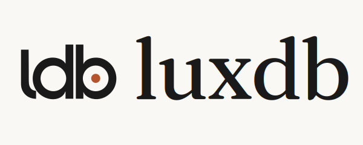

<p align="center">
  <a href="https://luxdb.net/">
    <picture>
      <source media="(prefers-color-scheme: dark)" srcset="assets/lockup-600-dark.png">
      <source media="(prefers-color-scheme: light)" srcset="assets/lockup-600-light.png">
      
    </picture>
  </a>
</p>

# LuxDB — luxury product database and price history API

LuxDB is a paid catalogue of luxury items with **weekly price and
availability history across countries' storefronts**, including items no longer
listed. Use it to compare recorded prices and research an item's history.

[Pricing: choose a plan or buy credits](https://luxdb.net/pricing) ·
[Catalogue](https://luxdb.net/catalog) · [API docs](https://luxdb.net/docs/api)

Subscriptions start at **$29/month for Collector (1,000 credits; no paid API)**.
API access is available with retail credits from **$50 once**, Pro or Business.
One credit opens an item card. See the access options and repeat rules below.

For resellers, dealers, analysts, journalists and developers. Records cover
Louis Vuitton, Hermès, Dior, Loewe, Kenzo, Givenchy and Tiffany & Co.
Coverage and observation dates vary by house, item and storefront.

LuxDB is an independent service and is not affiliated with, endorsed by, or sponsored by any of the houses mentioned. Their names and trademarks belong to their respective owners.

The storefront and API are live. This repository contains Python and
JavaScript/TypeScript clients, an OpenAPI specification and field definitions;
the paid catalogue records are accessed through LuxDB, not downloaded
with this repository. API contract version: **2.3.1**.

## Choose catalogue or API access

| Option | Price in USD | Credits | Paid API access |
|---|---|---|---|
| Retail credits | From $50 once | 1,000 in the smallest pack; never expire | Included |
| Collector | $29/month or $279/year | 1,000/month | Not included |
| Pro | $149/month or $1,429/year | 6,000/month | 1 key |
| Business | $499/month or $4,790/year | 25,000/month, pooled | 1 key per seat |

For current prices, allowances and purchase terms, use the
[pricing page](https://luxdb.net/pricing). A paid record requires paid access;
the public `demo` API key is limited to demo data and needs no account.

## Research with recorded product data

- **Resellers and dealers:** compare recorded storefront prices by country and
  inspect earlier observations when researching an item.
- **Analysts and journalists:** examine weekly price changes and listing history;
  retain the observation dates when reporting a comparison.
- **Collectors and buyers:** look up a reference and its available history,
  including records of items no longer listed.
- **Developers:** use the REST API's documented JSON fields and local Python or
  JavaScript/TypeScript clients in an integration.

Read the [data dictionary](https://luxdb.net/docs/data) to check the fields before
buying. Weekly observations are not a real-time stock guarantee. Storefront
prices are not resale transaction prices or an authentication of an item.

## Start offline

Python 3.10 or later; Node 18 or later for JavaScript. No key, network or runtime dependency is needed for the demo.

```sh
python3 -B examples/demo.py
node examples/demo.mjs
python3 -B tools/render_public.py --check
python3 -B tools/generate_clients.py --check
python3 -B -m unittest discover -s tests -v
node --test clients/js/test/*.test.mjs
python3 -B tools/check_public.py
```

- [Quickstart](docs/quickstart.md)
- [API reference](docs/api-reference.md)
- [Data dictionary](docs/data-dictionary.md)
- [Python client notes](docs/api-compatibility.md)
- [JavaScript and TypeScript client](clients/js/README.md)
- [Houses](docs/houses.md)

Public pages: [LuxDB](https://luxdb.net/), [Pricing](https://luxdb.net/pricing),
[API documentation](https://luxdb.net/docs/api), [Data dictionary](https://luxdb.net/docs/data)
and [Catalogue](https://luxdb.net/catalog). Catalogue access depends on your account.

The client uses the demo key by default. Paid keys require explicit opt-in. There
are no automatic retries, redirects or background downloads. Never share keys or
paid responses in a public report.

## Demo limits and contract notes

The shared demo key allows **1 request per minute and 300 per day per address**.
Each live example makes one call. Wait at least 60 seconds before another; on 429,
follow Retry-After. X-RateLimit-Remaining includes the request just served; at
the one-request-per-minute limit it reports 0.
The charge is the response body field credits_charged; there is no charge header.

Client types come directly from the supplied 2.3.1 contract, including nullable
prices and dimensions. A set main lists its sizes in size_set; its storefront
prices cover the set and identify the size whose price is shown. A sandbox member
code can be null while its size and storefronts remain visible.
HTTP errors retain extra keys in ApiError.details;
404 and 405 are ordinary API errors. See [compatibility notes](docs/api-compatibility.md).

## Questions before buying

### How does the 24-hour repeat work?

Opening an item card costs one credit. A repeat within its 24-hour window is
free. The website and API have separate repeat windows: opening on one does not
make the first opening on the other free. The API window is shared by the
account's keys. Check `credits_charged` in the response and the
[API documentation](https://luxdb.net/docs/api) for charging rules.

### Can I research items no longer listed?

Yes, where LuxDB has recorded them. "Not listed this week" describes an
observation, not a manufacturing decision. Delisted does not mean discontinued.
History starts with the observations available for that item; it is not a promise
of complete history from launch.

### Does the API include original photos and videos?

The API returns documented fields and media counts, not the media files.
Original media is accessed through the paid website card and its export.
Check the [field definitions](docs/data-dictionary.md) and
[API reference](docs/api-reference.md) for what each interface returns.

### Can I keep my downloads?

Downloads are yours to keep. A download link can expire; save the files while the
link is valid. Repository code and documentation licenses do not license the
catalogue data or third-party material.

### Is this a free luxury dataset?

The repository's clients and field definitions are public. Full catalogue access
is paid. The offline examples use synthetic responses; the public `demo` API key
serves only its sample selection. It is not unrestricted access to the archive.

## Support and licenses

Issues are off at launch. Contact support@luxdb.net privately for support or security.
Code and synthetic tests use [MIT](LICENSE); original docs use
[CC BY 4.0](LICENSES/CC-BY-4.0.txt). See [NOTICE](NOTICE.md) and
[Contributing](CONTRIBUTING.md). These licenses do not grant rights to catalogue data
or third-party material.

